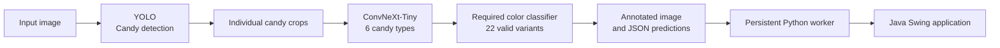

# Automatic Candy Selector (ACS)

**Automatic Candy Selector (ACS)** is a desktop computer-vision project that detects candies in photographs and identifies both their type and color variant. We built a Python inference pipeline combining **YOLO**, **ConvNeXt-Tiny**, and a **required variant-classification stage**, and connected it to a Java Swing application through a persistent Python worker.

The recognition catalog contains 6 candy types and 21 valid type–variant combinations. Detection, type classification, and variant classification are separate components. The application explicitly marks a variant as unresolved when the image does not provide enough information. An unresolved variant is not counted as a correct prediction in evaluation.

## System architecture



| Component | Implementation | Purpose |
| --- | --- | --- |
| Object detection | Ultralytics YOLO | Locate each candy (`bonbom`) with a bounding box |
| Type classification | PyTorch ConvNeXt-Tiny | Recognize one of six candy types |
| Variant classification | Per-type HSV/KNN classifier | Recognize the appropriate color variant **given the predicted type** |
| Inference orchestration | Python pipeline | Combine predictions, save annotated images, and produce JSON |
| Desktop application | Java Swing | Select images and display the system output |
| Communication | Persistent Python worker | Keep inference models loaded across requests |

The type and variant models are distinct: ConvNeXt has six output classes, and the variant component resolves one of the 22 valid type/color labels. For `fraise` and `oeuf`, the catalog has exactly one allowed variant, its label is determined by that catalog rule rather than a separate visual color measurement.

## Candy catalog and dataset

| Type | Variants |
| --- | --- |
| `crocodile` | `bleu`, `jaune`, `orange`, `rouge`, `vert` |
| `dragibus` | `bleu`, `jaune`, `noir`, `rose`, `rouge`, `vert` |
| `fraise` | `rouge` |
| `oeuf` | `blanc` |
| `ourson` | `blanc`, `jaune`, `orange`, `rouge`, `vert` |
| `schtroumpf` | `blanc`, `jaune`, `rouge` |

We organize source photographs by **type, variant**. Original images are retained under `datasets/v2/classification/raw/`; converted images are written to `datasets/v2/classification/processed/`. We use session-based splits instead of assigning highly correlated photographs randomly:

| Split | Sessions | Use |
| --- | --- | --- |
| Training | Model fitting |
| Validation | Hyperparameter selection and model validation |
| Independent test | Final evaluation of frozen models |

Photographs of the same physical candy or near-identical capture conditions should stay within one split. Grouped cross-validation over development sessions is supported for the ConvNeXt type model and `S04` is not used during that process.

For object detection, we use a single YOLO class: `bonbom`, with image and bounding-box annotation files under `datasets/v2/detection/yolo/`. Full-scene evaluation additionally requires per-object type and variant ground truth, stored separately from the YOLO training labels.

## Model configuration and outputs

All model settings, dataset paths, and deployment checkpoint paths are defined in `configs/`:

```text
configs/
├── classes.yaml           # Six types and 22 legal variants
├── classification.yaml    # ConvNeXt training, preprocessing and deployment
├── color.yaml             # REQUIRED per-type color/variant classifier
├── detection.yaml         # YOLO training, inference and scene evaluation
└── application.yaml       # Java/Python output and execution settings

models/
├── classification/convnext_tiny_best.pth
├── color/color_classifier.joblib
└── detection/yolo_best.pt
```

**Selected checkpoints are stored in `models/`.** Training histories, metrics, confusion matrices, and annotated predictions are stored in `results/`. The deployed application does not rely on checkpoint paths inside experimental result folders.

The project stops with an explicit error if the required variant checkpoint is missing or its class catalog is incomplete. A segmentation failure for an individual candy can still yield `unknown`; those cases are retained in reports and counted as incorrect complete type–variant predictions.

## Evaluation design

We evaluate the system at six distinct levels, using validation data during development and reserved test data for the final reported results:

| Evaluation | What is evaluated | Key outputs |
| --- | --- | --- |
| **1. Type classification** | Frozen ConvNeXt on isolated candy images | 6-class accuracy, precision, recall, macro-F1, confusion matrix |
| **2. Variant classification** | Variant model with the **true candy type provided** | 22-label report, accuracy, macro-F1, abstention rate; multi-variant-only accuracy |
| **3. Joint classification** | ConvNeXt **predicted type** followed by variant prediction | Exact type+variant accuracy, 22-class confusion matrix, macro-F1 |
| **4. Detection** | YOLO without type or variant classification | Precision, recall, mAP@50, mAP@50:95 |
| **5. End-to-end recognition** | YOLO boxes + type + variant on complete scenes | Box-matched localization, correct type/variant per object, end-to-end precision/recall/F1, exact-scene accuracy |
| **6. Final application** | Java/Python interaction and generated outputs | Worker protocol checks, image/JSON consistency, runtime measurements, manual GUI acceptance tests |

The difference between evaluations 2 and 3 is essential: in the **independent variant evaluation**, we supply the actual candy type to isolate the color model; in the **joint evaluation**, the variant model receives ConvNeXt's prediction, so type-classification errors affect the final result.

### Complete-scene ground truth

The detector needs only `bonbom` boxes to train. To evaluate the **complete pipeline**, the scene test set also includes a CSV with one row per candy:

```csv
image,x1,y1,x2,y2,type,variant
```

A `val_objects.csv` and `test_objects.csv` reference the corresponding images in `datasets/v2/detection/yolo/<split>/images`. Object matching uses configurable IoU (default 0.50). Missed objects, incorrect type/variant labels, unknown variants, and false-positive boxes **reduce full-system performance**. Negative images without candies are also processed.

For the operational application benchmark, the Python worker checks the same artifacts used by Java. **Interactive Swing usability remains a separate manual acceptance test**; a successful backend benchmark is not evidence that the GUI was tested automatically.

See [`docs/EVALUATION_PROTOCOL.md`](docs/EVALUATION_PROTOCOL.md) for metric definitions, the scene annotation format, and the application acceptance checklist.

## Repository structure

```text
AutomaticCandySelector/
├── configs/                    # Central configuration
├── datasets/v2/                # Classification and detection datasets
├── models/                     # Selected inference checkpoints
├── src/
│   ├── classification/         # ConvNeXt training and inference
│   ├── color/                  # Required variant model training/inference
│   ├── data/                   # Dataset conversion and preparation
│   ├── detection/              # YOLO training, evaluation and integration
│   ├── evaluation/             # Independent, joint and end-to-end reports
│   ├── pipeline.py             # Type + variant prediction
│   └── verify.py               # Configuration/checkpoint verification
├── java-app/src/main/java/     # Java Swing interface
├── worker.py                   # Persistent Python backend
├── tests/                      # Unit and integration tests
├── results/                    # Generated metrics and images
├── requirements.txt
└── README.md
```

## Reproducing experiments

Commands below are executed from the repository root. The project uses Python 3.11 (or a compatible Python/PyTorch installation) and a JDK providing `java` and `javac`.

### 1. Environment and dataset preparation

```bash
python -m pip install -r requirements.txt
python -m pytest -q tests
python -m src.data.prepare_classification
python -m src.classification.train --check-only
python -m src.color.train --check-only

cp datasets/v2/detection/yolo/data.yaml.example \
   datasets/v2/detection/yolo/data.yaml
python -m src.detection.train --check-only
```

### 2. Train all required models

```bash
# Type model: ConvNeXt-Tiny
python -m src.classification.train

# Variant model: required per-type classifier
python -m src.color.train

# Detector: YOLO
python -m src.detection.train --device cpu
```

When training finishes, the selected model checkpoints are placed in their respective `models/` subdirectories. The training scripts keep their plots and experiment histories in `results/training/`.

### 3. Development-set evaluation

```bash
# Optional research experiment: grouped ConvNeXt cross-validation (NO S04)
python -m src.evaluation.cross_validation

# Independent and joint classifier reports (validation)
python -m src.evaluation.classification --split val
python -m src.evaluation.color --split val
python -m src.evaluation.joint_classification --split val

# Detector and complete-scene evaluation (validation)
python -m src.detection.evaluate --split val
python -m src.evaluation.end_to_end --split val
```

The complete-scene command requires `datasets/v2/detection/annotations/val_objects.csv` with true bounding boxes and type/variant labels. The full labeling convention is documented in `docs/EVALUATION_PROTOCOL.md`.

### 4. Independent final tests

After checkpoint selection and all threshold decisions are frozen, the reserved data is evaluated **without retraining or further tuning**:

```bash
python -m src.evaluation.classification --split test
python -m src.evaluation.color --split test
python -m src.evaluation.joint_classification --split test
python -m src.detection.evaluate --split test
python -m src.evaluation.end_to_end --split test
```

The test scene evaluation requires `datasets/v2/detection/annotations/test_objects.csv`, which supplies **ground-truth type and variant for each object**. Test results are not used to choose models or adjust thresholds.

### 5. Integrated inference and Java desktop application

Once all three required checkpoints exist:

```bash
python -m src.verify --strict
python -m src.detection.integrated_pipeline --source path/to/image.jpg
```

To compile and launch the Java Swing interface on Linux/macOS:

```bash
export ACS_PROJECT_ROOT="$(pwd)"
export ACS_PYTHON="$(command -v python)"
mkdir -p java-app/build
javac -encoding UTF-8 -d java-app/build java-app/src/main/java/MainFrame.java
java -cp java-app/build MainFrame
```

The Python worker is persistent and emits `READY` when initialized. For each requested image, it returns `RESULT:<annotated-image-path>` and `DONE`, or an `ERROR:...` followed by `DONE`. Predictions are serialized to JSON and annotated images under `results/inference/`.

### 6. Application-level functional benchmark

The backend used by the Java application is checked with:

```bash
python -m src.evaluation.application --source path/to/scene_test_images
```

This verifies the worker protocol, generated images, JSON consistency, and total runtime including checkpoint loading. **GUI functionality is then checked with the separate manual acceptance protocol.**

## Experiment outputs

| Results | Location |
| --- | --- |
| ConvNeXt training curves | `results/training/classification/` |
| ConvNeXt grouped cross-validation | `results/evaluation/classification/cross_validation/` |
| Type classification reports | `results/evaluation/classification/{val,test}/` |
| Independent color/variant reports | `results/evaluation/color/{val,test}/` |
| Joint 22-variant classification reports | `results/evaluation/joint_classification/{val,test}/` |
| YOLO evaluation | `results/evaluation/detection/{val,test}/` |
| Full-scene end-to-end evaluation | `results/evaluation/end_to_end/{val,test}/` |
| Java/Python worker benchmark | `results/evaluation/application/` |
| Prediction images and JSON | `results/inference/` |

**Reproducibility note:** Evaluation scripts and report generation are included in the source. Quantitative results in the final report must be obtained by running the final datasets and trained checkpoints; automated tests and synthetic samples are not substitutes for those measurements.
